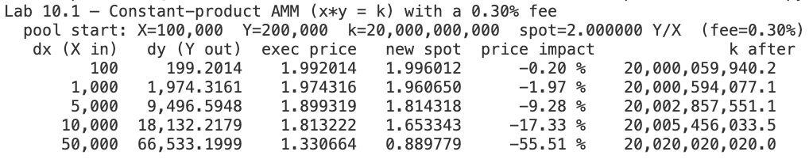
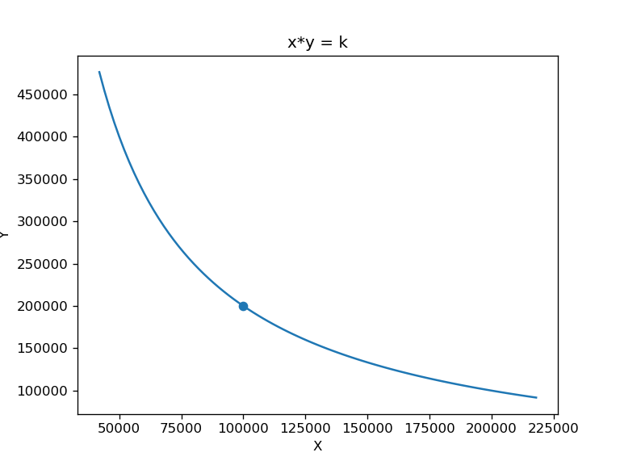
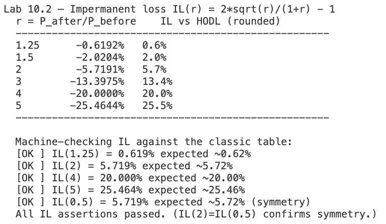
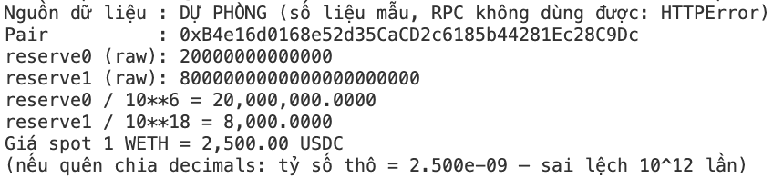
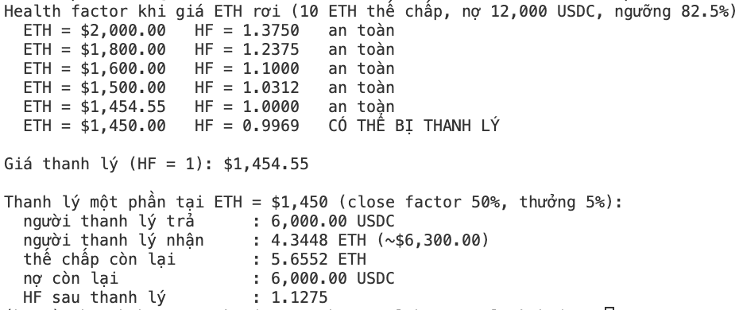

# Lab 10 — DeFi mechanics: AMM math, impermanent loss & lending

**Họ tên:** Phạm Thu Hà - 11247164

Files: `amm_il.py`, `read_pair_reserves.py`, `health_factor.py`.

---

## Bước 1 (15') — Lab 10.1: Constant-product AMM

Lệnh đã chạy:
```bash
python3 amm_il.py
```



→ Price impact tăng từ -0,20% (dx=100) đến -55,51% (dx=50,000), và `k after` luôn lớn hơn `20,000,000,000`.




**Q1 / Câu 1: A trade of dx=100 (0.1% of the X reserve) moves the price ~0.2%, but dx=50,000 (50% of the reserve) moves it ~55%. Why is price impact super-linear in trade size? / Vì sao price impact tăng phi tuyến theo cỡ lệnh?**

Trả lời: Mỗi đơn vị X đưa vào làm dự trữ X tăng và dự trữ Y giảm, nên đơn vị tiếp theo được đổi ở giá biên ngày càng xấu theo đường cong hyperbol x·y = k. Phần trăm impact tăng chậm lại ở quy mô lớn (lệnh lớn gấp 500 lần, impact chỉ tăng khoảng 277 lần), nhưng chi phí trượt giá so với giá spot tăng siêu tuyến tính: với dx=100 mất khoảng 0,80 Y (nhận 199,2014 thay vì 200), còn dx=50,000 mất khoảng 33.467 Y (nhận 66.533,20 thay vì 100.000). 

**Q2 / Câu 2: After every swap k = x*y is slightly larger than before. Where did the extra k come from, and who does it belong to? / Sau mỗi swap, k lớn hơn một chút — phần dư từ đâu và thuộc về ai?**

Trả lời: Phần k tăng thêm đến từ phí 0,3%: X đưa vào là dx đầy đủ, nhưng lượng Y trả ra chỉ tính trên dx sau khi trừ phí, nên phí ở lại trong pool. Phần dư này thuộc về các nhà cung cấp thanh khoản (LP), theo tỷ lệ cổ phần, và họ nhận khi rút thanh khoản. 

**Q3 / Câu 3: "Spot price" and "execution price" differ for every non-zero trade. Which one can you actually transact at, and why does a wallet show you slippage rather than the spot price? / Giá spot và giá thực thi khác nhau — bạn giao dịch được ở giá nào, và vì sao ví hiển thị trượt giá?**

Trả lời: Chỉ giao dịch được ở giá thực thi (dy/dx). Giá spot là giá biên cho một lệnh vô cùng nhỏ nên không có lệnh thật nào khớp ở đó. Ví hiển thị trượt giá và mức tối thiểu nhận được vì giá thay đổi theo cỡ lệnh và theo các giao dịch xếp trước trong khối; dung sai trượt giá làm giao dịch revert nếu giá thực thi xấu hơn mức cho phép. 

---

## Bước 2 (15') — Lab 10.2: bảng Impermanent Loss

Cùng lần chạy `amm_il.py`. Bảng IL (công thức IL(r) = 2·√r/(1+r) − 1, với r = P_after/P_before):




**Q4 / Câu 4: IL(2×) = IL(0.5×) = 5.72%. Explain in one sentence why the loss is symmetric. / Giải thích một câu vì sao IL đối xứng.**

Trả lời: IL chỉ phụ thuộc tỷ số giá r và công thức 2√r/(1+r) − 1 cho cùng giá trị khi thay r bằng 1/r, vì tài sản tăng gấp đôi hay giảm một nửa đều làm tỷ lệ giá hai token lệch khỏi mức ban đầu với cùng độ lớn tương đối. 

**Q5 / Câu 5: IL is called impermanent. Under what condition does it become permanent (realized), and name one thing that can offset it so an LP still profits overall. / Vì sao gọi là tạm thời? Khi nào nó thành vĩnh viễn, và điều gì có thể bù lại?**

Trả lời: IL gọi là "tạm thời" vì nếu giá quay lại mức ban đầu (r = 1) thì IL về 0. Nó thành vĩnh viễn khi LP rút thanh khoản lúc giá vẫn đang lệch. Phí giao dịch 0,3% mà LP tích lũy (hoặc phần thưởng khuyến khích thanh khoản) có thể bù lại để LP vẫn có lãi tổng thể. 

---

## Bước 3 (10') — Lab 10.3: đọc dự trữ pool qua RPC

Lệnh đã chạy:
```bash
python3 read_pair_reserves.py
```



**Q6 / Câu 6: The function returns raw integers reserve0, reserve1. Why must you divide by 10**decimals per token before taking the ratio? / Vì sao phải chia cho 10**decimals từng token trước khi lấy tỷ số?**

Trả lời: Mỗi token có số `decimals` khác nhau (USDC 6, WETH 18) và dự trữ trả về là số nguyên theo đơn vị nhỏ nhất của từng token. Nếu lấy tỷ số của hai số nguyên thô mà quên chia cho `10**decimals`, kết quả sai lệch 10¹⁸⁻⁶ = 10¹² lần: output của bài cho tỷ số thô `2.500e-09` thay vì `2,500`. 

---

## Bước 4 — Lab 10.4 (bonus): health factor và thanh lý

Lệnh đã chạy:
```bash
python3 health_factor.py
```



**Q7 / Câu 7: Solve for the liquidation price yourself: with 10 ETH, 12,000 USDC debt and an 82.5% threshold, at what ETH price does HF hit exactly 1? / Tự giải giá thanh lý.**

Trả lời: HF = (thế chấp × giá × ngưỡng) / nợ = 1, suy ra:

giá = nợ / (thế chấp × ngưỡng) = 12,000 / (10 × 0.825) = 12,000 / 8.25 ≈ **$1,454.55**

Khớp với dòng `Giá thanh lý (HF = 1): $1,454.55` của script.

---

